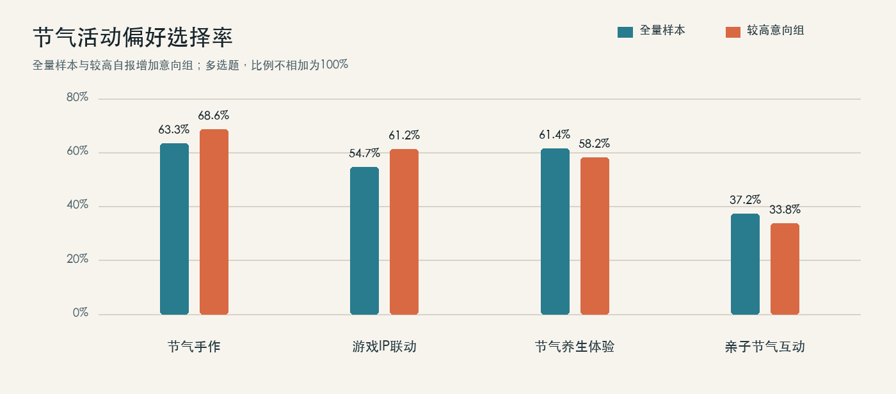
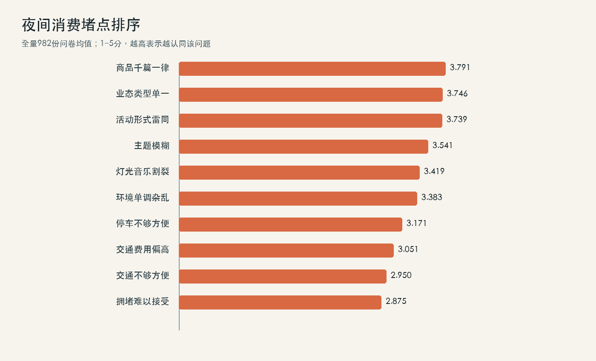

# NightPulse：北京夜间节气文化活动决策看板

NightPulse 是一个数据产品作品集案例。它把一项关于节气文化与北京夜间经济的五人团队调研，重构为帮助活动运营团队提出小规模试点假设的分析看板。

**作品集方向：数据分析、数据产品、AI 应用产品**  
**项目角色：五人团队核心参与者；参与研究设计、问卷实施、数据整理、分析建模、报告与演示等环节；成果署名第三顺位。**

> 当前版本展示的是调研数据上的决策分析原型，不是已经上线的运营系统，也没有真实客流或营收效果验证。

## 项目要回答什么

夜间文化活动运营者在立项前需要判断：

1. 哪些节气活动形式值得优先进入小规模试点？
2. 受访者最在意哪些夜间消费体验问题？
3. 不同当前消费行为的人群，在偏好上有哪些描述性差异？
4. 问卷关联能支持哪些试点假设，又有哪些结论不能下？

## 主要发现

- 节气手作选择率为 **63.3%**，节气养生体验为 **61.4%**。
- 评分最高的体验堵点为商品千篇一律（均值 **3.79/5**）、业态类型单一（**3.75/5**）和活动形式雷同（**3.74/5**）。
- 全特征逻辑回归的交叉验证 AUC 为 **0.926**；只使用当前夜间消费频率的模型 AUC 为 **0.891**，去掉该字段后为 **0.712**。
- 因此，模型适合作为行为分组与试点假设整理工具，不适合包装成个人级参与概率预测器。





## 交付结构

| 路径 | 内容 |
| --- | --- |
| `src/` | 数据审计与分析脚本 |
| `docs/` | 数据字典、数据质量报告、分析方案、结果与局限 |
| `results/aggregates/` | 聚合指标、模型汇总和可读规则；不含受访者级记录 |
| `results/figures/` | 可用于浏览项目结论的静态图表 |

## 本地运行

仓库没有附上问卷原始表或逐条问卷数据。只有在取得数据持有方授权、并拥有相应本地文件的情况下，才可运行完整流程。

```bash
python -m venv .venv
source .venv/bin/activate  # Windows PowerShell: .venv\Scripts\Activate.ps1
python -m pip install -r requirements.txt

python src/build_portfolio_dataset.py \
  --raw /path/to/authorized_raw.xlsx \
  --legacy-clean /path/to/authorized_legacy_clean.xlsx \
  --output-dir build/phase1

python src/run_initial_analysis.py \
  --input build/phase1/portfolio_analysis_v1_all_raw.csv \
  --output-dir build/phase2
```

旧版问卷清洗表及其处理依据不完整。流程会保留全量、旧版纳入和去重敏感性口径；对无法核实的删除原因不做“无效问卷”判断。

## 数据与方法边界

- 原始问卷 982 条；旧版纳入 932 条；旧版完全重复组去重敏感性样本 893 条。
- 50 条旧版未纳入记录没有可复核的排除依据；69 条溢价意愿改动缺少规则记录；收入旧编码存在行级映射风险。
- 模型标签是问卷中“节气活动后预计增加次数”高于全样本中位数 7 次，仅代表较高的自报意向。
- 问卷是观察性自报数据，不能代表北京市总体，也不能证明活动导致到访、消费或收入变化。
- 公开结果仅为聚合统计和模型摘要。任何实际运行者都应遵守数据持有方和团队的授权要求。

更多说明见 [`docs/04_数据质量报告_v0.1.md`](docs/04_数据质量报告_v0.1.md)、[`docs/05_项目定义与分析方案.md`](docs/05_项目定义与分析方案.md) 和 [`docs/06_初步分析报告_v0.1.md`](docs/06_初步分析报告_v0.1.md)。

## 团队成果与个人贡献

原项目由五人团队共同完成。本仓库不会把团队成果表述为个人独立成果。个人参与环节和本次作品集重构的新增工作，见 [`docs/个人贡献与团队边界.md`](docs/个人贡献与团队边界.md)。

原调研报告获得北京市人民政府人民建议征集办公室出具的采纳证明。该证明说明报告具有参考价值，不表示政府采用了本看板或模型，也不证明真实运营效果。本仓库不公开证明扫描件。

## 项目状态

- 数据审计、描述性分析、交叉验证模型和聚合图表：已完成初版。
- 在线 Dashboard：当前为私有只读版，公开前需完成授权与隐私确认。
- 站酷案例、5 分钟演示视频：后续作品集阶段。
- 数据及代码的公开许可：待确认团队与数据持有方的发布要求。
